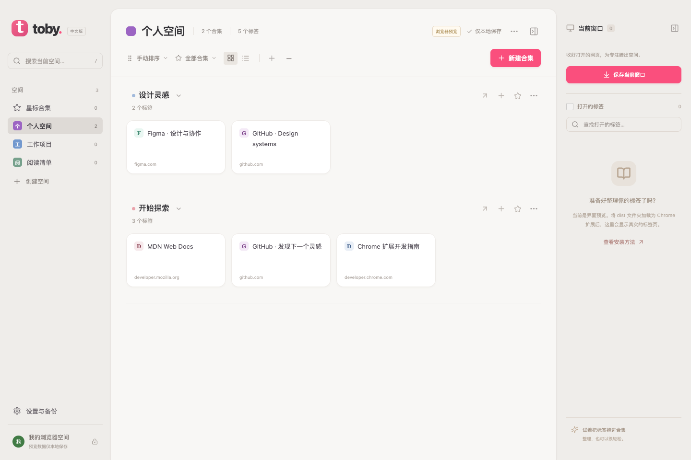

# Toby 中文版

一个可在本地加载的 Chrome 新标签页扩展。使用 React、TypeScript、Vite 和 Manifest V3 构建，数据只保存在当前浏览器的 `chrome.storage.local`，支持 JSON 备份导入、导出，无需账号或后端。

这是一个独立实现的开发项目，与其他同名产品没有隶属关系。当前尚未发布 Chrome 应用商店。

- [隐私说明](docs/PRIVACY.md)
- [贡献指南](CONTRIBUTING.md)
- [安全问题](SECURITY.md)
- [构建与发布](docs/RELEASING.md)
- [第三方依赖许可](THIRD_PARTY_NOTICES.md)



上图使用隔离的示例数据，展示普通浏览器预览模式，不包含个人浏览数据。

## 本地运行

需要 Node.js 22.18 或更新版本，以及 Chrome 120 或更新版本。

```sh
npm ci
npm run dev
```

打开终端输出地址下的 `/newtab.html`，例如：

<http://127.0.0.1:5173/newtab.html>

普通浏览器下是预览模式，合集数据保存在该站点的 localStorage。预览无法读取或关闭真实浏览器标签；页面右侧会明确提示。预览数据和扩展数据相互独立，可以用 JSON 导出、导入迁移。

## 加载 Chrome 扩展

```sh
npm run build
```

1. 在 Chrome 地址栏打开 `chrome://extensions`。
2. 打开右上角的「开发者模式」。
3. 点击「加载已解压的扩展程序」，选择本项目的 `dist` 文件夹。
4. 打开一个新标签页。如 Chrome 提示新标签页已变更，选择保留更改。

修改源码后重新运行 `npm run build`，在扩展管理页点击扩展的刷新按钮，然后刷新新标签页。工具栏上的扩展图标也能打开管理页。测试扩展时，先停用其他接管新标签页的扩展。

## 备份与换电脑

1. 打开「设置与备份」，点击「导出 JSON 备份」，将文件保存在自己选择的位置。
2. 在另一台电脑安装本扩展，打开「设置与备份」并点击「导入备份」。
3. 选择 JSON 文件，核对预览后确认导入。导入会创建新的空间副本，不覆盖原有内容。

所有内容仅在本机保存，不提供 Google 账号同步或其他自动云端同步。请定期导出备份；卸载扩展或删除浏览器配置前尤其需要备份。

### 从之前的开发版升级

直接重新构建并刷新原扩展，保留现有加载目录和扩展 ID，即可继续读取已保存在本机的空间、合集和标签。原有 JSON 备份仍可导入。

如果之前加载的是带固定 ID 的 `dist-sync` 开发版，先导出备份，再运行 `npm run build:fixed-id`，改为加载 `dist-fixed-id`。公钥和扩展 ID 保持原值，不再具有账户同步功能；不要同时启用两份相同 ID 的扩展。改路径或重新加载前均建议保留 JSON 备份。

`extension-identity.json` 只保存公开的扩展公钥，用于复现旧开发版的 ID，不是账户密钥。普通本地安装使用 `dist` 即可。

新版不会读取、写入或清理旧版留在 Chrome 账户中的副本。如果其他设备仍运行旧版，请一并更新或停用旧版，避免旧代码继续执行同步。

## 已实现

- 三级结构：左侧空间列表 → 当前空间的合集分区 → 合集下面的标签卡片；右侧保留当前窗口标签列表。
- 空间创建、重命名、颜色、删除及撤销；刷新后保留所选空间。
- 点击主区域的空间名或合集标题即可直接重命名；Enter 或点击其他位置保存，Esc 取消。中文输入法选字时不会提前保存，空名称会提示修正。
- 合集纵向排列，支持单独或批量折叠、展开；编辑合集可修改所属空间，也可把合集标题拖到左侧空间中移动。
- 合集创建、重命名、颜色、星标、删除和 15 秒内撤销。
- 手动、名称、最近更新排序；网格和列表视图。
- 手动添加链接、编辑标题和网址、移动到其他合集、删除及撤销。
- 保存当前窗口或勾选的标签到新合集或现有合集。
- 可选择保存成功后关闭标签，固定标签及保存时发生导航的标签保留。
- 将打开的标签拖入合集；拖动链接移动或排序；拖动合集标题调整顺序。
- 拖动合集时显示跟随鼠标的浮层预览和原位置占位；目标合集上下半区显示插入线，可放到最后。松开后平滑归位，Esc 可取消，并尊重系统的减少动画设置。
- 合集和链接标题、网址搜索；非输入状态按 `/` 或 `Cmd/Ctrl + K` 聚焦搜索。
- 单个链接打开、整个合集在新窗口恢复。
- JSON 备份导出、校验预览和合并导入。
- 同一本机的多个管理页即时更新，后台串行处理写入，防止并发修改相互覆盖。

首次使用会创建「开始探索」合集，包含 MDN、GitHub、Chrome 开发文档三个示例链接。可直接编辑或删除。

升级后，旧版的合集会自动归入「我的第一个空间」，保留原有合集 ID、链接和顺序。存储键保持不变，数据结构升级为版本 2；旧版 JSON 备份仍可导入。

## 数据与权限

- `storage`：保存合集和链接。
- `tabs`：读取当前窗口网页的标题和 URL。
- `favicon`：在扩展内读取 Chrome 提供的网站图标。
- 不需要网页注入脚本、站点访问权限、独立应用账号或云服务。空间、合集、标题和 URL 仅保存在本机。
- 扩展通过 Chrome 的图标接口显示网站 logo，不请求第三方图标服务；普通浏览器预览会请求网站自身的 `/favicon.ico`。加载失败时显示域名字母。
- 仅保存 HTTP/HTTPS 地址；不收集 Chrome 内置页面或无痕标签。
- 相同合集按标准化后的完整 URL 去重；不同路径、参数或锚点视为不同链接。不同合集可以保存相同网址。
- 导入支持版本 1 和 2、最大 5 MB、最多 100 个空间、1000 个合集和 10000 个链接的合法备份。导入创建新空间副本，保留合集与标签的归属，不覆盖现有数据。
- 卸载扩展或删除浏览器配置会清除本地数据，请定期导出 JSON 备份。
- Chrome 不允许扩展替换无痕窗口的新标签页。

## 验证

```sh
npm test
npm run build
npm run test:e2e
```

浏览器测试默认使用本机安装的 Google Chrome，创建隔离的测试浏览器上下文，不使用个人浏览器配置。可在 `playwright.config.ts` 中调整浏览器 channel。

CI 使用 Playwright Chromium；本地也可以通过 `TOBY_TEST_BROWSER=chromium npm run test:e2e` 切换浏览器。首次使用需要运行 `npx playwright install chromium`。

还提供真实扩展测试，覆盖新标签页接管、真实标签保存、写入失败时不关闭标签、固定标签保留、拖拽、并发写入及合集恢复：

```sh
npx playwright install chromium
npm run test:extension
```

这组测试使用 Playwright 的 Chromium 和临时配置目录，不会修改个人 Chrome 设置。

## 代码结构

```text
public/manifest.json       Chrome 权限、新标签页和后台配置
src/App.tsx                交互界面
src/CollectionSection.tsx  合集分区
src/ui.tsx                公用 UI
src/styles.css             界面与响应式布局
src/model.ts               数据结构、命令处理、备份校验
src/platform.ts            Chrome API 与浏览器预览适配
src/background.ts          数据写入队列、工具栏入口
src/local-store.ts         本地存储、旧版升级与写入队列
scripts/build-fixed-id.mjs  兼容旧开发版身份的本地构建
src/model.test.ts          数据完整性与操作测试
tests/                     浏览器集成测试
```

测试覆盖本地存储失败恢复、并发写入、旧数据升级和 JSON 备份往返；真实扩展测试同时检查管理操作不会调用账户存储。

## 上传 GitHub

仓库结构已整理，MIT 许可证、隐私说明、贡献指南和 CI 工作流均在根目录或对应文档目录。按 [发布说明](docs/RELEASING.md) 将源码上传到 `Orange8/toby-zh`。

不要上传整个工作目录：`node_modules`、构建输出、个人工具设置、环境文件、私钥和浏览器备份不属于源码。`.gitignore` 会在使用 Git 时排除这些文件；通过 GitHub 网页上传时，需要自行按源码包内容选择文件。

## 项目许可

本项目采用 [MIT 许可证](LICENSE)，由 [Orange8](https://github.com/Orange8) 维护。第三方依赖许可已列在 [THIRD_PARTY_NOTICES.md](THIRD_PARTY_NOTICES.md)，并随构建产物附带。
